# Windows 10.8.2 ArcGIS Installation and Download Tutorial

ArcGIS is a powerful and widely used comprehensive geographic information system (GIS) software developed by the Environmental Systems Research Institute (Esri) in the United States.

ArcGIS is a powerful and widely used comprehensive geographic information system (GIS) software platform developed by the Environmental Systems Research Institute (Esri) in the United States. It excels in aspects such as data collection, management, analysis, visualization, and sharing, making it a benchmark product in the GIS field.

It possesses a rich set of functional modules, encompassing mapping creation, data analysis, and spatial modeling among other areas. Through ArcGIS, users can effortlessly create 2D and 3D maps, utilizing a diverse symbol library and style to produce aesthetically pleasing and professional-looking map products. Additionally, the software provides powerful spatial analysis tools, such as buffer analysis, superimposition analysis, network analysis, etc., to help users uncover patterns and trends in data and address practical issues. For instance, in urban planning, ArcGIS can be utilized for decision support in traffic flow analysis and public facility site selection.

ArcGIS supports the import and processing of various data formats, including vector data, raster data, real-time data, etc., facilitating users in integrating data from different sources for unified management. Additionally, ArcGIS boasts robust community support and a wealth of online resources, allowing users to exchange experiences, share resources, and seek assistance within the community. With continuous advancements in technology, ArcGIS continues to integrate new technologies such as AI and big data, evolving from traditional map tools into a spatial intelligence platform that provides core support for addressing complex geographical issues.

# **I. Installation Guide**

**1. The installation package can be found online. If it cannot be downloaded, you may try downloading it from gitee.com/FIRC/fircfiles/blob/master/arcgis10.8.2.md. The file downloaded is as follows:**

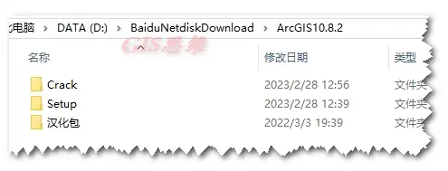

Editor

**2. The overall installation process is very simple, consisting of installing the main program + replacing the cracked files + installing the localization package.** Firstly, enter the Setup folder and select ArcGIS_Desktop_1082_180378.exe, double-click.

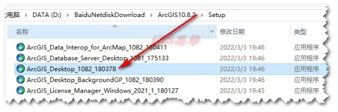

Editor

Select the program's unpacking path, which can be changed. Generally, the installation file of the program after unpacking can be deleted.

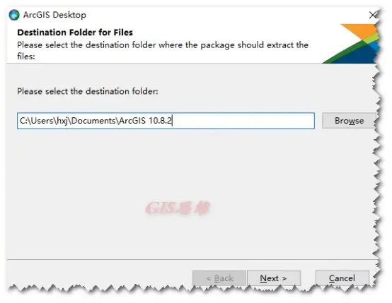

Editor

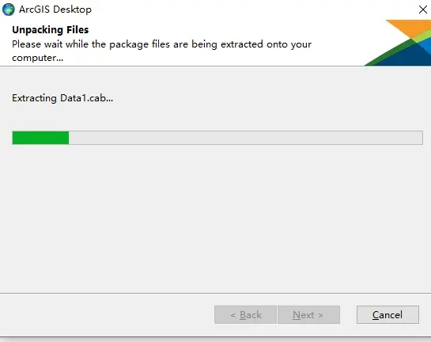

Editor

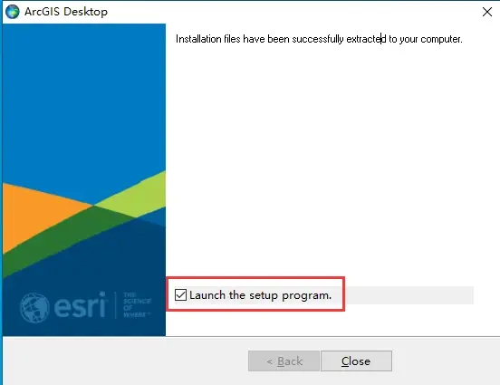

Editor

**3. Starting the official installation process**. After unpacking, the default option is checked for "Launch the setup program". Click "Close" and the installer will automatically start, following the basic steps of "Next".

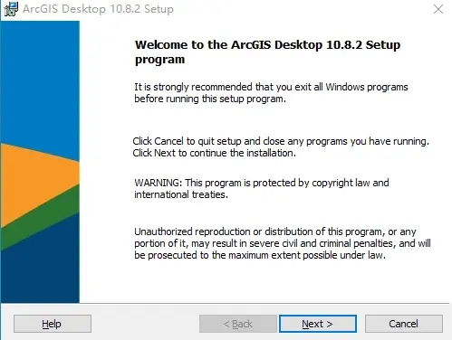

Editor

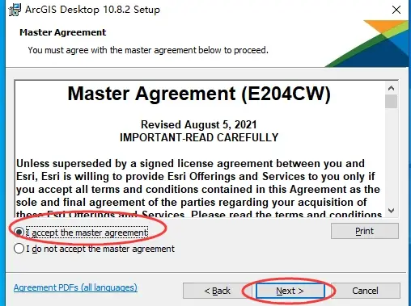

Editor

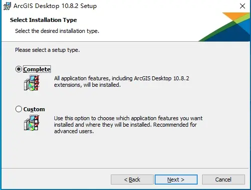

Editor

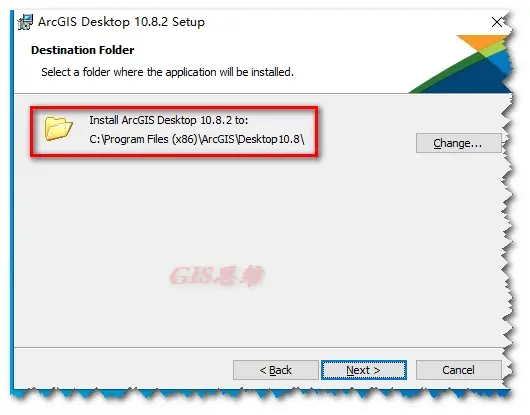

Editor

It is best to keep the default installation path unchanged.

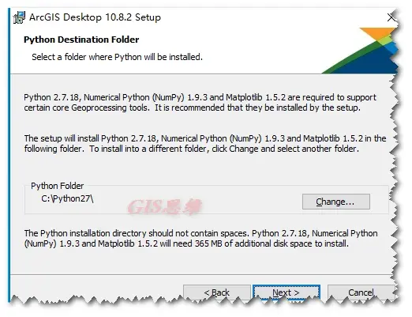

Editor

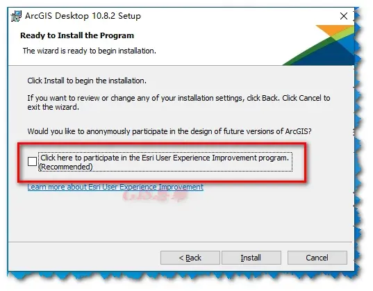

Editor

Uncheck the box for participation in the improvement plan, then click Install to begin installation.

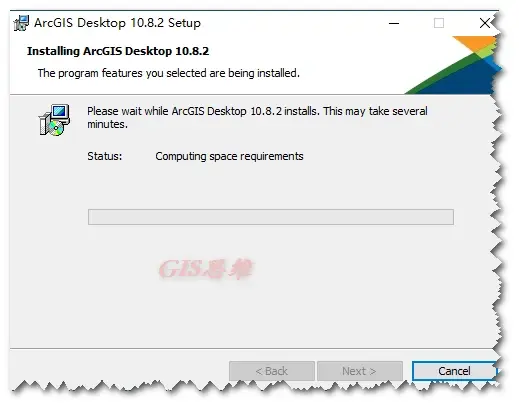

Editor

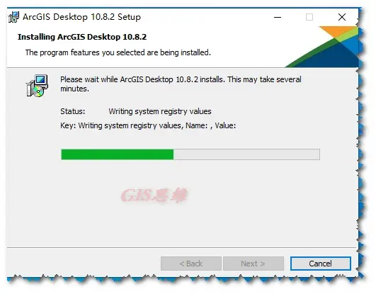

Editor

Wait for the software installation to finish.

Wait for the pop-up to finish, then click Finish.

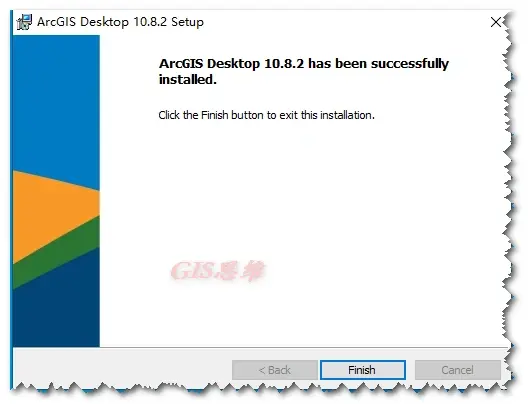

Editor

Close the pop-up window afterward.

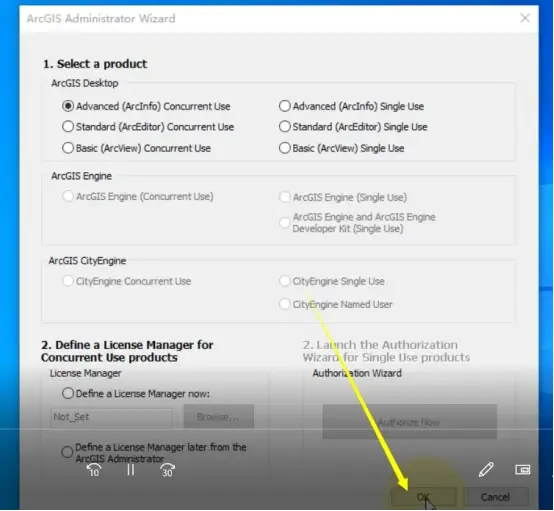

Editor

**Click OK to close.**

**4. Start the activation process.** Copy the Afcore.dll file from the Crack folder to the software installation path: C:\Program Files (x86)\ArcGIS\Desktop10.8\bin.

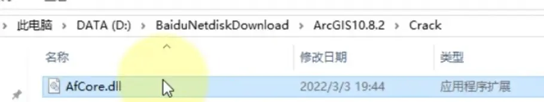

Editor

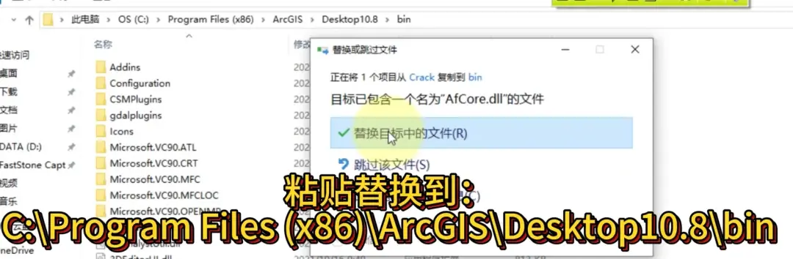

Editor

**5.****ArcMap can be launched in the Startup Program. At this time, since it has not been localized yet, it is still in English version.**

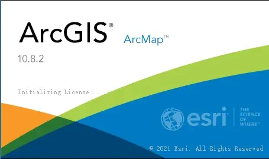

Editor

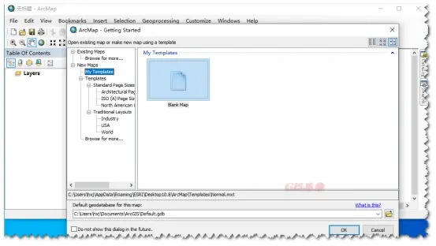

Editor

6. Chinese localization.

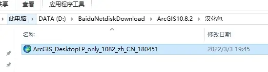

Editor

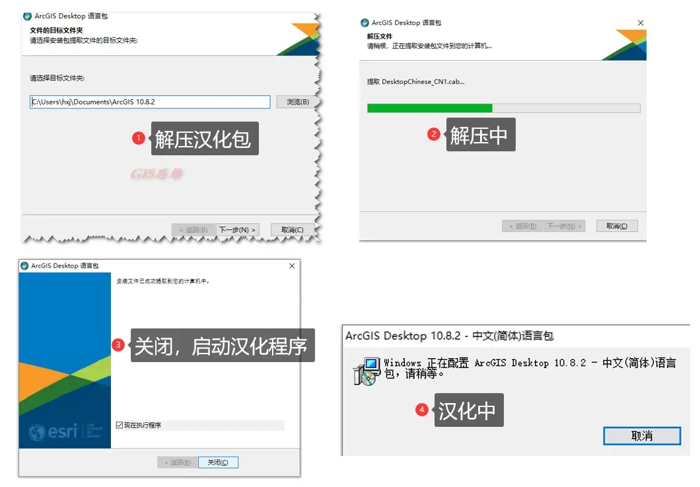

Editor

**Installation is complete. The reboot has been completed with Chinese localization.**

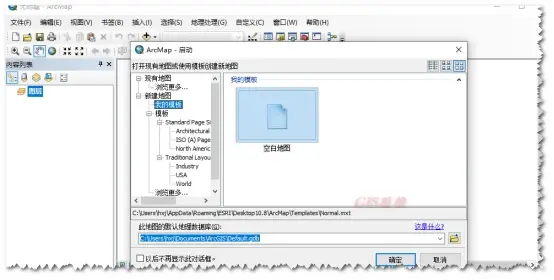

Editor

## Payment

Here is a pay link on Stripe ( https://buy.stripe.com/3cs8yP7sY87d0vu9AB ). Please contact me lonlonago@foxmail.com after funding $89, and I will send you a complete data files , thank you!

